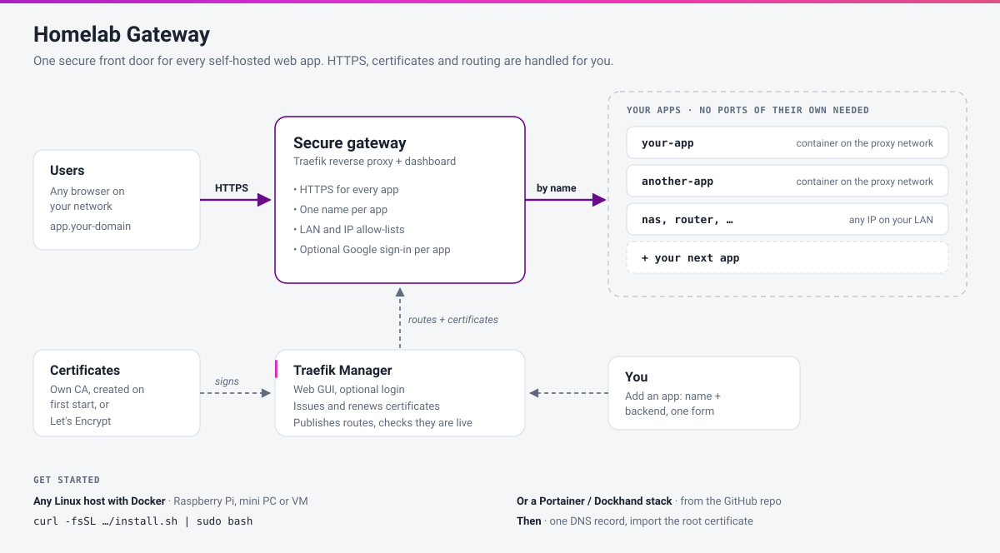

# Homelab Gateway

Traefik v3 in front of your self-hosted apps, plus **Traefik Manager**, a small web GUI that
issues a certificate for each app (from your own CA, or from Let's Encrypt) and writes the Traefik
config for it.

Adding an app: create the DNS record, put the container on the `proxy` network, fill in one form.

It runs on any Linux host with Docker: a Raspberry Pi, a mini PC, a VM. Deploy it with Portainer,
Dockhand or plain `docker compose`.

The original design and acceptance criteria are in [SPEC.md](SPEC.md). The author's own deployment
is described in [docs/lab.md](docs/lab.md).

## Diagrams

| Diagram | For |
|---|---|
| [Concept](docs/hld-concept.svg) | One-page overview of the idea, for presenting it |
| [Concept, host view](docs/hld-concept-host.svg) | The same overview, showing every component as a container on one host, managed by Portainer |
| [Technical design](docs/hld-technical.svg) | Generic data and control plane |
| [Example lab](docs/architecture-lab.svg) | One real deployment: hosts, ports, folders and PKI |



## What runs

| Container | Role |
|---|---|
| `traefik` | The only container publishing 80/443. Reads route and cert config from `/opt/traefik/dynamic` (file provider, watched). |
| `traefik-manager` | GUI at `https://<MANAGER_FQDN>` (also `http://<host-ip>:8090` as a fallback). Signs certs with the intermediate CA, writes `app-<slug>.yml` files, renews certs automatically. Prebuilt image: `ghcr.io/gjerdingc/traefik-manager` (amd64, arm64, armv7). |

The Traefik dashboard is at `https://<MANAGER_FQDN>/dashboard/`. The GUI and the dashboard share one name, split by path.

Killing the manager does not affect traffic: Traefik only reads the files the manager wrote.

## Requirements

- A Linux host with **Docker Engine and the Compose plugin**. Portainer or Dockhand are optional.
- Ports **80 and 443 free** on the host (stop any other reverse proxy first).
- A **domain or subdomain** for your apps, e.g. `lab.example.com`, and a **DNS server on your LAN**
  where you can add records (Pi-hole, AdGuard Home, your router). The domain only has to exist publicly
  for Let's Encrypt certificates (optional, recommended).

## Quick start

The examples use `lab.example.com` for the domain, `192.168.1.10` for the host and `192.168.1.0/24` for the LAN.

### With the installer (plain Docker)

```bash
curl -fsSL https://raw.githubusercontent.com/gjerdingc/homelab-gateway/main/install.sh | sudo bash
```

It checks Docker and ports 80/443, asks for your domain (it suggests the host IP, LAN and time zone), offers to set up Let's Encrypt, then creates the `proxy` network and starts the stack in `/opt/homelab-gateway`. At the end it prints the DNS record to add, where to download the root certificate and its fingerprint.
Run it again later to update; it keeps your settings. `--help` shows the options, including `--yes` for answers from environment variables.

Then continue with [step 4](#4-open-it-and-trust-the-root-certificate). To see what it runs first, download it and read it before running it with `sudo bash install.sh`.

### By hand, or with Portainer or Dockhand

### 1. Network

```bash
docker network create proxy
```

The `proxy` network is shared with your apps, so it lives outside the stack. Skip this if it already exists. Docker creates the folders under `/opt/traefik` on the first deploy.

### 2. DNS

Point the manager's name at the host, e.g. `traefik.lab.example.com -> 192.168.1.10`.
Easiest: a **wildcard record** `*.lab.example.com -> 192.168.1.10`, so every app you add later resolves without another DNS entry.

### 3. Deploy

**Portainer or Dockhand:** add a stack from a Git repository: `https://github.com/gjerdingc/homelab-gateway`, compose path `docker-compose.yml`. Enter the variables below as the stack's environment variables.

**Plain Docker:**

```bash
git clone https://github.com/gjerdingc/homelab-gateway && cd homelab-gateway && cp .env.example .env
```

Edit `.env`, then:

```bash
docker compose up -d
```

The variables you must set:

| Variable | Example | Notes |
|---|---|---|
| `MANAGER_FQDN` | `traefik.lab.example.com` | GUI and dashboard |
| `ALLOWED_DOMAINS` | `lab.example.com` | Names outside this are refused. The internal CA is limited to these |
| `LAN_CIDRS` | `192.168.1.0/24` | For the `lan-only` middleware |

Recommended: `HOST_IP` (`192.168.1.10`, used by the DNS check) and `TZ` (e.g. `Europe/Oslo`, default `UTC`). A login for the GUI is set in the GUI itself, under [Settings](#login).
[`.env.example`](.env.example) lists every variable with an example; the full list is under [Configuration](#configuration).

On first start the manager creates its own certificate authority for `ALLOWED_DOMAINS` (see [Certificates](#certificates)). There is nothing to prepare.

### 4. Open it and trust the root certificate

Open `https://traefik.lab.example.com`. Your browser warns about the certificate the first time, because it doesn't know the new CA yet: accept it once, or use `http://192.168.1.10:8090` (no TLS).
If neither loads, look at **Status** and **Log** on the `:8090` address.

On **Status**, choose **Download root certificate** and install it on your devices; the page shows how for Windows, macOS, Linux, Firefox, iPhone and Android. From then on every app you add with the internal CA is trusted on those devices.

### 5. Recommended: Let's Encrypt

Installing the root certificate works for your own devices. For apps that guests, family or work laptops use, set up [Let's Encrypt](#lets-encrypt-certificates): those certificates are trusted everywhere, without installing anything. It takes an API token from your DNS provider and two variables.

## Configuration

| Variable | Default | Notes |
|---|---|---|
| `MANAGER_FQDN` | – | Required. The GUI and the Traefik dashboard. Must be inside `ALLOWED_DOMAINS` |
| `ALLOWED_DOMAINS` | – | Required. Comma-separated. Apps can only use names under these |
| `LAN_CIDRS` | – | Required. Comma-separated. The manager, and apps with *LAN only*, only answer these clients |
| `CA_KEY_PASSWORD` | – | The intermediate key's password. For a CA the manager creates, set it before the first start to get an encrypted key; then it is needed on every start |
| `CA_AUTO_CREATE` | `true` | Create a CA on first start when `PKI_DIR` has none. `false` to never do that, `force` to make a new one even though apps hold certs from an old one |
| `CA_CERT_FILE` / `CA_KEY_FILE` | `intermediate_ca.crt` / `intermediate_ca_key` | File names inside `PKI_DIR/intermediate` |
| `ROOT_CA_FILE` | `root_ca.crt` | File name inside `PKI_DIR/root` |
| `HOST_IP` | – | This host's LAN IP. The DNS check warns when an app name resolves elsewhere. (`PI_IP` is the old name and still works) |
| `TZ` | `UTC` | Time zone for logs and the daily usage totals |
| `TM_ROOT` | `/opt/traefik` | Host folder for `dynamic`, `certs`, `manager`, `logs` and `acme` |
| `PKI_DIR` | `/opt/traefik/pki` | Host folder holding `intermediate/` and `root/` |
| `BREAK_GLASS_PORT` | `8090` | Host port for direct access to the manager. `192.168.1.10:8090` listens on one address only |
| `PROXY_NETWORK` | `proxy` | The external Docker network shared with your apps |
| `TM_VERSION` | `latest` | Manager image tag. Pin a release, e.g. `1.0.0`, to choose when you upgrade |
| `TM_IMAGE` | `ghcr.io/gjerdingc/traefik-manager` | For a fork with its own image |
| `TM_PULL_POLICY` | `always` | `missing` to skip the image check on every deploy |
| `BASIC_AUTH_USERS` | – | Optional. Sets the GUI login from the stack instead of on the Settings page, and overrides it there: htpasswd entries, e.g. from `htpasswd -nB me`. In a `.env` file write each `$` as `$$` |
| `RESET_LOGIN` | `false` | `true` removes the login set on the Settings page at startup (forgotten password). Remove it again afterwards |
| `DASHBOARD_ENABLED` | `true` | Route `/dashboard/` to the Traefik dashboard |
| `KEY_TYPE` | `rsa-2048` | `rsa-2048` or `ec-p256` for issued certs |
| `CERT_VALIDITY_DAYS` / `RENEW_BEFORE_DAYS` / `RENEW_CHECK_HOURS` | `365` / `30` / `12` | See [Renewal](#renewal) |
| `STATS_RETENTION_DAYS` / `ACCESS_LOG_MAX_MB` | `90` / `50` | See [Usage statistics](#usage-statistics) |
| `TRAEFIK_API_URL` / `TRAEFIK_HTTPS_PORT` | `http://traefik:8080` / `443` | Only if you change the Traefik service |

Let's Encrypt: `LETSENCRYPT_ENABLED`, `ACME_DNS_PROVIDER`, the provider's credentials, `ACME_EMAIL`, `ACME_CA_SERVER`, `ACME_DNS_RESOLVERS` (see [Let's Encrypt certificates](#lets-encrypt-certificates)).
Google sign-in: `SSO_ENABLED`, `SSO_DOMAIN`, `SSO_AUTH_URL` (see [Google sign-in](#google-sign-in)).

## Updating

The manager image is built by GitHub Actions for every push to `main` (tag `latest`) and every release tag (`1.0.0`, `1.0`).

- **Portainer:** **Pull and redeploy**, with **Re-pull image** switched on to be sure.
- **Installer:** run it again.
- **Plain Docker:** `git pull && docker compose up -d`

The manager has `pull_policy: always`, so every deploy checks for a newer image. Set `TM_PULL_POLICY=missing` on a host without internet access.

With `TM_VERSION` pinned, change it to the new release and redeploy. Your apps and certificates are in `TM_ROOT` and survive any redeploy.

**Building from source instead** (to test a branch, or for a fork without its own image): add [`docker-compose.build.yml`](docker-compose.build.yml).
With plain Docker: `docker compose -f docker-compose.yml -f docker-compose.build.yml up -d --build`. In Portainer, add it under *Additional paths* on the stack, if your version offers that.

## Host folders

| Host | Used for |
|---|---|
| `/opt/traefik/dynamic` | Generated config. `_core.yml` and `app-*.yml` belong to the manager. **`manual-*.yml` is yours** and is never touched. |
| `/opt/traefik/certs` | Issued certs and keys, one folder per app. Current and previous pair are kept. |
| `/opt/traefik/manager` | `apps.yml` (source of truth), `archive/` (deleted apps), `manager.log`, `stats.json` (usage). Back this up. |
| `/opt/traefik/logs` | Traefik's JSON access log, read by the manager for the Usage page. |
| `/opt/traefik/acme` | `acme.json`: Traefik's Let's Encrypt account key and certificates. Traefik only; contains private keys. Back this up. |
| `/opt/traefik/pki/intermediate` | Intermediate cert and key, mounted into the manager only. Back this up. |
| `/opt/traefik/pki/root` | Root **certificate** only, mounted into the manager and (read-only) Traefik. Keep no root key here. |

`/opt/traefik` is `TM_ROOT` and `/opt/traefik/pki` is `PKI_DIR`. Backing up both folders is a full backup.

## Login

By default anyone who can reach the manager (the LAN, narrowed by **Manager access**) can use it. To require a login, open **Settings**, enter a username and password and choose **Turn on login**. Your browser then asks for it.

- It covers the GUI, the Traefik dashboard and the break-glass port 8090: Traefik checks it on the manager's route, and the manager checks it itself on every request, which is what protects the port that bypasses Traefik.
- Only a bcrypt hash is stored, in `/opt/traefik/manager/auth.yml`.
- The root certificate (`/status/root_ca.crt`) and the health check stay open, so anyone allowed to reach the manager can still set up a device.
- **Change** the username or password on the same page, or **Turn off login** there.
- **Forgot the password?** Set `RESET_LOGIN=true` in the stack and redeploy: the manager starts without a login. Set a new one, then remove the variable.
- `BASIC_AUTH_USERS` in the stack takes precedence; the Settings page then only shows it.

## Adding an app

1. Create the DNS record for the new name, pointing at the host (not needed with a wildcard record).
2. Put the app's container on the external `proxy` network and remove its published `ports:`:
   ```yaml
   services:
     myapp:
       networks: [proxy]
   networks:
     proxy:
       external: true
   ```
3. In the GUI: **Add app**, enter slug, FQDN and backend (`http://container:port`). **Preview YAML** shows what will be written.
4. The app detail page shows DNS, backend and Traefik checks, and has an end-to-end TLS check.

Editing the names (FQDN or extra SANs) issues a new certificate. Traefik picks it up without a restart because each cert is written to a new file name.

After every change the manager waits until Traefik has actually reloaded the file (usually about 2 seconds) before it reports success. To tell the new version from the old one, each generated file contains an unused middleware named `tm-rev-<app>-<hash>`. You will see these in the Traefik dashboard; they are not attached to any router. If Traefik refuses the new version, the previous config is put back.

Hand-written config goes in `/opt/traefik/dynamic/manual-<name>.yml`. A router there needs its own certificate in a `tls.certificates` entry, otherwise Traefik serves the default certificate for that name.

## External services

Not everything is a container on the `proxy` network. Pi-hole, a firewall web UI, Uptime Kuma, Unraid, or Portainer's own port on this host can also go behind the gateway. Add them with **Add external service** (or choose *External service* in the form) and give an IP or host name as the backend, e.g. `https://192.168.1.1:443` or `https://192.168.1.10:9443` for Portainer.

- External services are listed in their own section on the Apps page, with a dashed border.
- Traefik connects from the container host, so the service must accept connections from the host's IP. For a port published on this host, use the host's LAN IP, not `localhost`.
- Many appliances serve a self-signed certificate. Tick **Do not verify the backend's TLS certificate**, otherwise Traefik answers 500.
- The service stays reachable at its own address too, so Portainer keeps working on `:9443`. Restrict it on the service or the firewall if it should only be reachable through the gateway.
- Internal apps must use a container name; an IP address is refused with a hint to choose External service.
- Some web UIs live under a sub-path, e.g. Pi-hole at `/admin/`. Set **Start path** to `/admin/` and opening `https://pihole.lab.example.com/` redirects there. Only the bare `/` is redirected; every other path reaches the service unchanged. This works for internal apps too.

## Restricting source addresses

Any app or external service can be limited to certain clients. Other clients get 403. With nothing set, any source is allowed.

- **IP lists** (in the menu) are named sets of addresses and subnets, IPv4 or IPv6, e.g. `admins` with your admin workstations or `vpn` with `10.8.0.0/24`. Define a list once, then add it to the apps that should use it: pick it from the IP lists dropdown on an app's form (an app can have several), or pick the apps on the list's own page to add or remove many at once.
- **Extra addresses for this app** on the app form adds entries just for that app.
- A client is let in if it matches any ticked list or any extra address. The manager merges them into one `ipAllowList` middleware named `<slug>-sources` in the app's file.
- Editing a list rewrites every app that uses it, and waits for Traefik to load each one. If Traefik rejects one, the list and all files go back to how they were. A list in use can't be deleted (remove its apps on the list's page first), and a list must have at least one entry, so an app can't quietly end up open to everyone. If an app still names a list that has gone from `apps.yml` (a hand edit or an old backup), the app admits no one until you fix it, and its page marks the list as missing.
- **The manager itself** (and the Traefik dashboard) can be limited the same way: open the `_manager` entry and choose **Edit access**, or add `_manager` to a list on the list's page. This comes on top of `LAN_CIDRS`, which always applies to the manager. If a save would block the address Traefik sees for you, the manager asks you to confirm first. If you do lock yourself out, use the break-glass port (`http://<host-ip>:8090`, which does not go through Traefik) and clear the list.
- The source check comes on top of **LAN only**: with both on, a client must be in `LAN_CIDRS` and match the app's sources. To let in an address outside `LAN_CIDRS`, untick LAN only for that app.
- Traefik checks the address it sees as the source. If clients reach it through NAT or another proxy, every client may appear as the same address.

## Certificates

Each app chooses where its certificate comes from, under **Certificate** on its form:

- **Internal CA**: issued by the manager. Always available. Devices need the root certificate installed.
- **Let's Encrypt** (recommended, optional): publicly trusted, so phones, guests' devices and tools with their own trust store accept it without installing anything. Traefik obtains and renews it itself; the manager only writes `tls.certResolver: letsencrypt` on the app's router. Once it is set up, new apps start with it selected.

The manager's own name (`MANAGER_FQDN`) always uses the internal CA.

### The internal CA

On the first start, if `PKI_DIR` holds no CA, the manager creates one and writes it to the **Log**:

- A root and an intermediate certificate, both with a **name constraint** for `ALLOWED_DOMAINS`. Devices that trust the root therefore accept it only for names under your domains, never for your bank: even someone who took over the manager could not use it against other sites.
- The **root key is thrown away** once it has signed the intermediate. It is never written to disk, so nothing can create another intermediate under your root. The intermediate is valid for 10 years, the root for 20.
- The intermediate key is in `PKI_DIR/intermediate`, encrypted if `CA_KEY_PASSWORD` was set at the first start. Back the folder up; with it, a reinstall keeps the same CA and devices keep trusting it.

Download the root certificate from **Status** and install it on your devices. Check that the SHA-256 fingerprint the device shows matches the one on **Status**.

**Adding a domain later:** the CA can only sign names under the domains it was made for. If you add one to `ALLOWED_DOMAINS`, the manager shows a warning. Use Let's Encrypt for names under the new domain, or make a new CA: stop the stack, move `PKI_DIR` aside, set `CA_AUTO_CREATE=force` and start it. Certificates are reissued from the new CA as they are renewed (or press **Renew now** on each app), and every device needs the new root certificate.

The manager never replaces a CA that is there. If the CA files are missing but apps already hold certificates, it refuses to make a new one and shows an error instead, because a mistyped `PKI_DIR` is the likelier cause.

### Your own CA

To use a CA you already have, put the intermediate cert and key in `PKI_DIR/intermediate/` and the root cert in `PKI_DIR/root/` before the first start, and set `CA_CERT_FILE`, `CA_KEY_FILE`, `ROOT_CA_FILE` and `CA_KEY_PASSWORD`. Both PKCS#8 and traditional key formats work, including keys made with `step`. Give the intermediate a name constraint if you can.

To make one yourself with `openssl` and keep the root key (offline), run this as root in `PKI_DIR`; it asks for a password for each key:

```bash
DOMAIN=lab.example.com
openssl genpkey -algorithm RSA -pkeyopt rsa_keygen_bits:4096 -aes-256-cbc -out root/root_ca.key
openssl req -x509 -new -key root/root_ca.key -sha256 -days 3650 -subj "/CN=Home Lab Root CA" \
  -addext "basicConstraints=critical,CA:TRUE" -addext "keyUsage=critical,keyCertSign,cRLSign" -out root/root_ca.crt
openssl genpkey -algorithm RSA -pkeyopt rsa_keygen_bits:3072 -aes-256-cbc -out intermediate/intermediate_ca_key
openssl req -new -key intermediate/intermediate_ca_key -subj "/CN=Home Lab Intermediate CA" -out intermediate.csr
printf '%s\n' "basicConstraints=critical,CA:TRUE,pathlen:0" "keyUsage=critical,keyCertSign,cRLSign" \
  "nameConstraints=critical,permitted;DNS:$DOMAIN" "subjectKeyIdentifier=hash" "authorityKeyIdentifier=keyid" > intermediate.ext
openssl x509 -req -in intermediate.csr -CA root/root_ca.crt -CAkey root/root_ca.key -CAcreateserial \
  -days 1825 -sha256 -extfile intermediate.ext -out intermediate/intermediate_ca.crt
openssl verify -CAfile root/root_ca.crt intermediate/intermediate_ca.crt
```

Then **move `root/root_ca.key` off the host**: the `root` folder is mounted into both containers. Set `CA_KEY_PASSWORD` to the intermediate key's password.

## Let's Encrypt certificates

Traefik proves control of the name with a **DNS-01 challenge**: it creates a `_acme-challenge.<name>` TXT record through your DNS provider's API, Let's Encrypt looks it up, and Traefik removes it. Nothing has to be reachable from the internet and the app's own A record can stay on the LAN DNS only.

### Which DNS provider

What matters is who hosts the domain's **public DNS**, not where you bought it. Any registrar works, as long as the DNS is at a provider with an API Traefik supports. These are wired into `docker-compose.yml`:

| `ACME_DNS_PROVIDER` | Variables | API access |
|---|---|---|
| `cloudflare` (default) | `CF_DNS_API_TOKEN` | API token with **Zone / DNS / Edit** and **Zone / Zone / Read** on the zone |
| `route53` (AWS) | `AWS_ACCESS_KEY_ID`, `AWS_SECRET_ACCESS_KEY`, `AWS_REGION`, optional `AWS_HOSTED_ZONE_ID` | IAM user allowed to change records in the hosted zone |
| `digitalocean` | `DO_AUTH_TOKEN` | Personal access token with write scope |
| `hetzner` | `HETZNER_API_TOKEN` | API token for the project holding the DNS zone |
| `ovh` | `OVH_ENDPOINT` (e.g. `ovh-eu`), `OVH_APPLICATION_KEY`, `OVH_APPLICATION_SECRET`, `OVH_CONSUMER_KEY` | Application keys with rights on `/domain/zone` |
| `porkbun` | `PORKBUN_API_KEY`, `PORKBUN_SECRET_API_KEY` | API keys, with **API access** switched on for the domain |

**Another provider:** find its code and variable names on [Traefik's provider list](https://doc.traefik.io/traefik/https/acme/#providers), set `ACME_DNS_PROVIDER` to the code, and add its variables to the `traefik` service's `environment:` in `docker-compose.yml` the same way (`NAME: ${NAME:-}`).

**Registrar without a usable API** (GoDaddy limits its API for small accounts; Namecheap needs an IP allow-list): keep the domain registered there, and move its nameservers to a free DNS host such as Cloudflare, Hetzner or deSEC.

### Set up once

At your DNS provider:

1. The domain must be served by that provider **on the public internet** (the registrar points at its name servers). Internal-only records can stay on your LAN DNS; the provider only needs to hold the temporary TXT records.
2. Create the API credentials from the table above, limited to this one zone where the provider allows it.
3. If the zone has **CAA** records, add one that allows Let's Encrypt: `example.com CAA 0 issue "letsencrypt.org"`. With no CAA records at all, nothing is needed.

In the stack:

4. Make sure `/opt/traefik/acme` exists.
5. Add these variables, then redeploy:

| Variable | Value | Notes |
|---|---|---|
| `LETSENCRYPT_ENABLED` | `true` | Shows the Let's Encrypt option on the app form |
| `ACME_DNS_PROVIDER` | e.g. `cloudflare` | Default `cloudflare` |
| *(the provider's variables)* | *(the credentials)* | Given to Traefik only, the manager never sees them. Never commit these |
| `ACME_EMAIL` | e.g. `you@example.com` | Optional; the Let's Encrypt account contact |
| `ACME_CA_SERVER` | `https://acme-staging-v02.api.letsencrypt.org/directory` | Optional; use staging while testing (its certs are not trusted). Remove it for real certs |
| `ACME_DNS_RESOLVERS` | `1.1.1.1:53,1.0.0.1:53` | Default. Public resolvers used to check the TXT record |

6. Edit an app, choose **Let's Encrypt** and save. Traefik loads the router at once and serves its default certificate (the manager's internal one) for a minute or two until the new certificate arrives. The app's **Certificate** check shows what Traefik actually serves, and turns green once it is a trusted Let's Encrypt certificate.

### Good to know

- Traefik renews Let's Encrypt certificates about 30 days before they expire. The manager's renewal (below) skips these apps, and **Renew now** is not offered for them. Problems show up in Traefik's log (search for `acme`), not in the manager log.
- The names become public in Certificate Transparency logs (e.g. crt.sh). Use the internal CA for names you don't want listed.
- Changing an app's names makes Traefik request a new certificate. Switching an app back to the internal CA issues an internal certificate again.
- Let's Encrypt has rate limits (50 certificates per registered domain per week, 5 duplicates per week). Use `ACME_CA_SERVER` staging while experimenting. When you switch from staging to production, delete `/opt/traefik/acme/acme.json` and redeploy, so Traefik does not keep serving staging certificates.
- The challenge record is checked on public resolvers (`ACME_DNS_RESOLVERS`), not on the LAN DNS, because a LAN DNS server may answer for the domain itself and never see the TXT record.
- Wildcards are still not supported; each app gets a certificate for its FQDN and extra names.
- The manager's own name (`MANAGER_FQDN`) keeps its internal certificate.
- With Let's Encrypt set up, the app form selects it for new apps. You can still pick the internal CA per app.

## Google sign-in

Apps you pick can require a Google sign-in before Traefik lets a request through. The sign-in itself is done by **oauth2-proxy**, a separate stack ([`oauth2-proxy/docker-compose.yml`](oauth2-proxy/docker-compose.yml)). The manager only adds a ForwardAuth middleware to those apps' routers.

How a request goes: the app's router runs `sso@file`, which first removes any `X-Auth-Request-*` headers the client sent, then asks oauth2-proxy. With a valid sign-in cookie oauth2-proxy answers 202 and Traefik passes the request on, with `X-Auth-Request-Email` and `X-Auth-Request-User` set to the signed-in user. Without a cookie the browser goes to Google, back to `https://auth.<SSO_DOMAIN>/oauth2/callback`, and on to the page it asked for. One sign-in covers every app under `SSO_DOMAIN`.

The examples use `lab.example.com` as `SSO_DOMAIN`.

### Set up once

1. **Google Cloud Console** > APIs & Services:
   - *OAuth consent screen*: user type *External*, publishing status *Testing*, and add the Google accounts that may sign in as test users. Add your `SSO_DOMAIN` as an authorised domain.
   - *Credentials > Create credentials > OAuth client ID*, type *Web application*, authorised redirect URI `https://auth.lab.example.com/oauth2/callback`. Copy the client ID and secret.
2. **The allow-list** on the host, one email address per line (oauth2-proxy lets in only these):
   `sudo mkdir -p /opt/oauth2-proxy && echo "you@gmail.com" | sudo tee /opt/oauth2-proxy/emails.txt`
3. **Deploy the oauth2-proxy stack**: same repository, compose path `oauth2-proxy/docker-compose.yml`, with these variables:

| Variable | Value |
|---|---|
| `OAUTH_CLIENT_ID` | From step 1 |
| `OAUTH_CLIENT_SECRET` | From step 1. Never commit this |
| `OAUTH_COOKIE_SECRET` | `openssl rand -base64 32 \| tr -- '+/' '-_'` |
| `SSO_DOMAIN` | `lab.example.com` (required) |
| `TZ` | Optional, default `UTC` |

4. **In the Traefik stack**, add the variables below and redeploy. The Status page shows *Google sign-in: available*.

| Variable | Value | Notes |
|---|---|---|
| `ALLOWED_DOMAINS` | must include `lab.example.com` | The sign-in domain must be allowed |
| `SSO_ENABLED` | `true` | Shows *Require Google sign-in* on the app form |
| `SSO_DOMAIN` | `lab.example.com` | Same as in the oauth2-proxy stack. Apps with sign-in must have all their names under it |
| `SSO_AUTH_URL` | `http://oauth2-proxy:4180` | Default. oauth2-proxy as Traefik sees it on the proxy network |

5. **Add the sign-in route** as an ordinary app: slug `auth`, FQDN `auth.lab.example.com`, backend `http://oauth2-proxy:4180`, *without* sign-in (the manager refuses it there). Create the DNS record if you have no wildcard.
6. **Pick apps**: edit an app under `SSO_DOMAIN`, tick **Require Google sign-in** and save. The app list marks it *sign-in*.

### Good to know

- Who may sign in is decided by `/opt/oauth2-proxy/emails.txt`. Restart the oauth2-proxy container after changing it.
- An app gets the user from `X-Auth-Request-Email`. Only trust it when the app is reached through Traefik: an app with a published host port can be called around the gateway with any header.
- Sign-in needs internet access to Google. Sign out at `https://auth.<SSO_DOMAIN>/oauth2/sign_out`.
- The cookie is valid for every app under `SSO_DOMAIN`, so each of them receives it.
- Turning `SSO_ENABLED` off while apps still require sign-in does not open them: their routers point at a middleware that no longer exists, so Traefik rejects them (404) until sign-in is removed from the app or turned back on. Scripts and monitors that call an app need a route without sign-in.
- The manager's own GUI is not behind Google sign-in; it keeps the LAN allow-list and its own optional [login](#login).

## Renewal

Every `RENEW_CHECK_HOURS` the manager renews certs with fewer than `RENEW_BEFORE_DAYS` days left. A cert already limited by the intermediate's own expiry is not renewed repeatedly. Results are on **Status**; failures show as a red banner on every page.

## Usage statistics

The **Usage** page shows, per app, for the last 7, 30 or 90 days:

- **Page views:** successful GET requests for pages, not files or API calls (`/static/`, `/api/`, anything with a file extension except `.html`). Approximate.
- **Visitors:** distinct client IP addresses per day.
- **Requests, errors (5xx) and when the app was last used**, plus a daily chart and the top pages per app.

Traefik writes a JSON access log to `/opt/traefik/logs/access.log`. The manager reads new lines every 5 minutes (or when you press **Refresh**) and keeps daily totals in `/data/stats.json` for `STATS_RETENTION_DAYS` days. Days follow `TZ`. When the log grows past `ACCESS_LOG_MAX_MB`, the manager empties it once everything in it has been counted.

Privacy: the totals keep client IPs only as salted hashes, but the raw access log contains IPs until it is emptied. Lower `ACCESS_LOG_MAX_MB` to keep less.

Traefik's access log goes to that file instead of the container output, so it does not show in the container logs.

## Troubleshooting

| Symptom | Likely cause |
|---|---|
| Stack fails to start: `manifest unknown` or `denied` pulling `ghcr.io/.../traefik-manager` | The image for that `TM_VERSION` does not exist yet, or the package is private. Check the repository's *Packages*, or build from source with `docker-compose.build.yml`. |
| Stack fails to start: `network proxy declared as external, but could not be found` | Run `docker network create proxy` once. |
| Red banner "CA not loaded: ... CA_KEY_PASSWORD" | Wrong or missing password. Both PKCS#8 and traditional `step` key formats are supported. If the password is right and it still fails, convert once: `openssl pkcs8 -topk8 -v2 aes-256-cbc -in intermediate_ca_key -out intermediate_ca_key.p8`, then set `CA_KEY_FILE=intermediate_ca_key.p8` (keep the original). |
| Red banner "No CA files were found, but apps already hold certificates" | `PKI_DIR` does not point at your CA (often after moving to a new host or changing the variable). Fix `PKI_DIR`. To really start over with a new CA, set `CA_AUTO_CREATE=force`; see [The internal CA](#the-internal-ca). |
| Red banner "Root CA certificate ... not found" or "CA key not found" | Some CA files are there and some are not. The manager only creates a CA when none of them exist. Restore the missing file, or move the folder aside to get a new CA. |
| Warning "The internal CA can only sign names under ..." | `ALLOWED_DOMAINS` has a domain the CA was not made for. See *Adding a domain later* under [The internal CA](#the-internal-ca). |
| Backend check: "name does not resolve" | The app container is not on the `proxy` network, or the name is wrong. |
| External service gives 500 | The backend uses a certificate Traefik doesn't trust (self-signed). Tick "Do not verify the backend's TLS certificate". |
| External service gives 502 or times out | Traefik can't reach the IP and port from the container host. Check the service's own firewall or allow-list. |
| DNS check red | The DNS record is missing or misspelled. |
| Let's Encrypt certificate never arrives | Search Traefik's log for `acme`. Usually wrong `ACME_DNS_PROVIDER`, missing or under-privileged credentials, or a CAA record that does not allow Let's Encrypt. |
| 403 from a LAN client | `lan-only` is on and Traefik sees a different source IP. Check the Traefik access log. Docker can hide the client IP in some setups (e.g. IPv6). Untick "LAN only" for that app or fix `LAN_CIDRS`. If the app has **Allowed source IPs**, the client must be in that list too. |
| Browser shows a certificate warning | The root certificate is not installed on that device, or the name is not in the cert's SANs. |
| "Traefik rejected the config, so nothing was changed" | The message is Traefik's own error. The previous config is restored. |
| Status shows Traefik unreachable | The manager reaches Traefik's API at `TRAEFIK_API_URL` (default `http://traefik:8080`) on the proxy network. Both containers must be on it. |

## Security notes

- The intermediate CA key is readable by the manager container. Anyone who compromises the manager can issue certs that your devices trust, for any name the intermediate is allowed to sign. The CA the manager creates is limited to `ALLOWED_DOMAINS` and has no root key to make more; for your own CA, add a name constraint and keep the root key offline.
- The GUI is protected by LAN allow-listing only, until you turn on the [login](#login). **Turn it on** on any network you share with people or devices you don't fully trust. Until it is on, anyone who can reach the manager can also be the one to set it.
- The fallback port 8090 bypasses Traefik and its allow-list (the login still applies). Keep it on the LAN, or bind it to one address with `BREAK_GLASS_PORT`.
- Issued private keys are unencrypted on disk, as Traefik requires. The GUI never offers them for download.
- The Traefik API is unauthenticated, but its port is not published to the host.

Hardening ideas, in order of value: a name-constrained issuing sub-CA for the manager (the manager already honours name constraints), Google sign-in for the manager itself, step-ca for signing, shorter cert lifetimes. See SPEC.md section 10.

## Development

```bash
cd manager && pip install -r requirements.txt && pytest
```

The integration test runs a real Traefik against the generated config and is skipped unless you set `TRAEFIK_BIN` (CI downloads the version the stack uses and runs it):

```bash
TRAEFIK_BIN=/path/to/traefik pytest tests/test_integration_traefik.py
```

To run your changes in a stack, build from source with [`docker-compose.build.yml`](docker-compose.build.yml) (see [Updating](#updating)).

**Releases:** push a tag `v1.2.3` on `main`. The [image workflow](.github/workflows/image.yml) tests, builds for amd64, arm64 and armv7, and pushes `ghcr.io/<owner>/traefik-manager:1.2.3` and `:1.2`.
